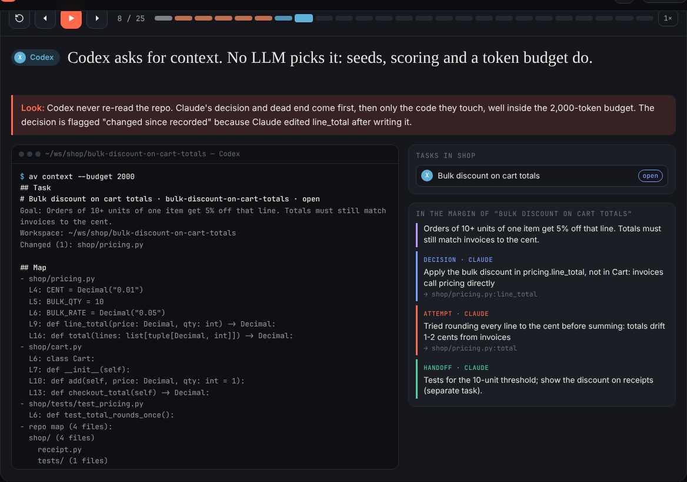

# Scholion

**Your next Claude Code session starts knowing last session's dead ends.** Scholion pins one-line notes (decisions, and what didn't work) to the code they
are about, and hands the next session a small brief built from them. One agent, one repo, no
second subscription needed. On a small Python repo that meant 12.9 % fewer turns at the same cost
([benchmark](bench/results/2026-10-27-haiku/)).

Use more than one agent and the same memory crosses vendors: Claude Code starts a job, Codex
picks it up from the brief, Gemini reviews it, and the reviewer merges.

*σχόλιον (scholion): a note written in the margin of a manuscript. Scholion keeps notes in the
margins of your code, so your AI agents stop forgetting.*

[](https://github.com/vinhqbui/scholion/stargazers)
[](https://github.com/vinhqbui/scholion/actions/workflows/ci.yml)
[](LICENSE)
[](https://github.com/vinhqbui/scholion/releases)

## A short story

**Monday.** Claude Code spends an hour on a flaky network call. First it tries the obvious fix,
a retry library, and finds out the library isn't installed in production. Then it finds the real
fix, gets halfway, and runs out of context.

**Tuesday.** Codex picks the job up. Git shows it a diff and nothing else. So it reads the whole
repo again, reaches for the same retry library, hits the same wall, and burns the same hour.

**Tuesday, with Scholion.** Codex opens the task and gets a one-page brief: the goal, what's done,
*"tried the retry library: not installed in prod, don't"*, and the three files that matter. It
starts where Claude stopped. Gemini reviews the work, and the reviewer merges it.

Git remembers **what** changed. Scholion also remembers **why**, and **what didn't work**, and
hands it to whichever agent comes next.

[](https://scholion.openevaluations.si/demo)

**[Watch the recorded run](https://scholion.openevaluations.si/demo)**

## Why it exists

Many developers now pay for more than one agent subscription, such as Claude Code, Codex, Gemini, Grok or Cursor, because each model is better at something different. Today those agents cannot share what they learned about your code, so every handoff between them is a diff with no reasoning, and each one starts from zero and repeats the dead ends of the others. Scholion gives all your subscriptions one repository, one backlog and one shared memory, so the next agent, from any vendor, starts where the last one stopped.

## What you get

- **Notes in the margin.** Agents leave one-line notes (decisions, dead ends) pinned to the code
  they touched. When any agent opens that file later, the note comes with it.
- **A brief instead of a re-read.** Every agent starts from a small brief, sized to a token
  budget: the goal, the history that matters, and the code to look at.
- **One backlog for all your agents.** Claude Code, Codex, Gemini, Cursor and Grok share it. Each
  takes the work it's best at, another agent reviews it, and the reviewer merges.
- **A dashboard** at `http://localhost:7420/ui` to watch them work.
- **A disk that stays lean.** Workspaces of merged and abandoned tasks are removed after an hour
  with their build output, a Rust repo's tasks build lean (a fifth of the disk of a default
  `cargo test`, each task in its own target dir), and the hooks tell an agent what it left outside
  its workspace. `av disk` shows where the space went; `av gc` reclaims it.

It runs on your machine. No Docker and no account, and it never sees your model keys.

## Does it help?

Measured so far, including where it didn't help:

- On a small Python repo, Claude Code needed **12.9 % fewer turns per task at the same cost**
  ([benchmark](bench/results/2026-10-27-haiku/)).
- When one agent's lessons were passed on to the next, cost per solved task dropped by about
  **42 %**, and 30 of 30 tasks were solved instead of 18. Scholion did as well as a hand-written
  `NOTES.md`, without anyone having to write it.
- Not measured yet: large repositories.

## Try it

**The easy way: ask Claude.** Add the Scholion plugin to Claude Code once:

```bash
claude plugin marketplace add vinhqbui/scholion
claude plugin install scholion@scholion
```

Then open Claude Code in your repository and say *"set up Scholion for this repo"* (or run
`/scholion:setup`). Claude installs it, connects your agents and checks that everything works.
`/scholion:team` sets up several agents to share one backlog, and `/scholion:doctor` fixes a setup
that isn't working.

**By hand** (Linux, macOS on Apple silicon, or Windows through WSL):

```bash
curl -fsSL https://raw.githubusercontent.com/vinhqbui/scholion/main/scripts/install.sh | sh
cd your-repo && av init                       # starts Scholion, adds this repo, connects Claude Code
av init --for codex --for gemini --for cursor # the same for other agents
```

Restart your agent, then ask it to *"start an av task to …"*. Open `http://localhost:7420/ui` to
watch.

Other channels ([details](docs/install.md)):

```bash
cargo binstall --git https://github.com/vinhqbui/scholion scholion-cli   # prebuilt, no compile
brew tap vinhqbui/scholion https://github.com/vinhqbui/scholion && brew install scholion
docker run -d -p 127.0.0.1:7420:7420 -v scholion:/data ghcr.io/vinhqbui/scholion
```

## ⭐ If it helps, star it

Scholion is a small open-source project. If it saved your agents a re-read, a
[star](https://github.com/vinhqbui/scholion/stargazers) is how other people find it.
Bugs and ideas are welcome in [issues](https://github.com/vinhqbui/scholion/issues).

## Learn more

- **[Reference](docs/reference.md)**: every command, configuration, the Docker stack, design,
  architecture and the full measurements.
- [Changelog](CHANGELOG.md) · [Contributing](CONTRIBUTING.md) · [Benchmarks](bench/README.md)
- The CLI is `scholion`, with the short alias `av`.

**How it was built.** Scholion is vibe-coded: AI coding agents (mostly Claude Code) wrote almost all
of the code, tests and docs, with one human steering and reviewing. Treat it as an experiment, not
as audited infrastructure. Some of the design borrows ideas from Anthropic's public article
[Redesigning source control](https://www.anthropic.com/research/redesigning-source-control).
Scholion is an independent project, **not affiliated with or endorsed by Anthropic**.

**Editions.** This repository is the free Community edition ([MIT](LICENSE)). It works with any
number of agents, with no seat limit. A hosted Commercial edition, **Scholion Cloud**, is planned but not available yet.
